# Organogram

Single entry point: **chief-of-staff**. Owner → Chief of Staff → Department Leads → Specialists.

```mermaid
flowchart TD
  OWNER[Owner: Mehrab] --> COS[chief-of-staff]
  COS --> product_lead["Head of Product<br/>Product & Strategy"]
  product_lead --> module_spec_writer["module-spec-writer"]
  product_lead --> pricing_credits_analyst["pricing-credits-analyst"]
  product_lead --> market_localization_researcher["market-localization-researcher"]
  COS --> cto["CTO<br/>Platform Engineering"]
  cto --> backend_lead["backend-lead"]
  cto --> supabase_schema_engineer["supabase-schema-engineer"]
  cto --> credits_ledger_engineer["credits-ledger-engineer"]
  cto --> api_gateway_engineer["api-gateway-engineer"]
  cto --> job_queue_engineer["job-queue-engineer"]
  cto --> frontend_lead["frontend-lead"]
  cto --> user_panel_engineer["user-panel-engineer"]
  cto --> admin_panel_engineer["admin-panel-engineer"]
  cto --> i18n_engineer["i18n-engineer"]
  cto --> infra_lead["infra-lead"]
  cto --> worker_devops_engineer["worker-devops-engineer"]
  cto --> cloudflare_edge_engineer["cloudflare-edge-engineer"]
  cto --> module_factory_lead["module-factory-lead"]
  cto --> skill_to_module_converter["skill-to-module-converter"]
  cto --> media_module_engineer["media-module-engineer"]
  cto --> document_module_engineer["document-module-engineer"]
  cto --> research_seo_module_engineer["research-seo-module-engineer"]
  COS --> ciso["CISO<br/>Security & Compliance"]
  ciso --> auth_2fa_engineer["auth-2fa-engineer"]
  ciso --> appsec_reviewer["appsec-reviewer"]
  ciso --> abuse_policy_reviewer["abuse-policy-reviewer"]
  ciso --> legal_docs_drafter["legal-docs-drafter"]
  COS --> qa_lead["QA Lead<br/>QA & Release"]
  qa_lead --> test_engineer["test-engineer"]
  qa_lead --> e2e_browser_tester["e2e-browser-tester"]
  qa_lead --> release_manager["release-manager"]
  COS --> cmo["CMO<br/>Growth & Brand"]
  cmo --> brand_naming_strategist["brand-naming-strategist"]
  cmo --> multilingual_copywriter["multilingual-copywriter"]
  cmo --> seo_lead["seo-lead"]
  cmo --> tutorial_video_producer["tutorial-video-producer"]
  cmo --> landing_page_designer["landing-page-designer"]
  cmo --> social_content_manager["social-content-manager"]
  COS --> cfo["CFO<br/>Revenue & Finance"]
  cfo --> payments_integration_engineer["payments-integration-engineer"]
  cfo --> billing_ops_analyst["billing-ops-analyst"]
  COS --> coo["COO<br/>Automation & Operations"]
  coo --> workflow_automation_engineer["workflow-automation-engineer"]
  coo --> support_agent_designer["support-agent-designer"]
  coo --> analytics_engineer["analytics-engineer"]
  COS --> office_lead["Executive Office Lead<br/>Executive Office"]
  office_lead --> governance_secretary["governance-secretary"]
  office_lead --> digital_assets_desk["digital-assets-desk"]
```

## Roster

| Department | Lead | Specialists |
|---|---|---|
| Product & Strategy | `product-lead` | `module-spec-writer`, `pricing-credits-analyst`, `market-localization-researcher` |
| Platform Engineering | `cto` | `backend-lead`, `supabase-schema-engineer`, `credits-ledger-engineer`, `api-gateway-engineer`, `job-queue-engineer`, `frontend-lead`, `user-panel-engineer`, `admin-panel-engineer`, `i18n-engineer`, `infra-lead`, `worker-devops-engineer`, `cloudflare-edge-engineer`, `module-factory-lead`, `skill-to-module-converter`, `media-module-engineer`, `document-module-engineer`, `research-seo-module-engineer` |
| Security & Compliance | `ciso` | `auth-2fa-engineer`, `appsec-reviewer`, `abuse-policy-reviewer`, `legal-docs-drafter` |
| QA & Release | `qa-lead` | `test-engineer`, `e2e-browser-tester`, `release-manager` |
| Growth & Brand | `cmo` | `brand-naming-strategist`, `multilingual-copywriter`, `seo-lead`, `tutorial-video-producer`, `landing-page-designer`, `social-content-manager` |
| Revenue & Finance | `cfo` | `payments-integration-engineer`, `billing-ops-analyst` |
| Automation & Operations | `coo` | `workflow-automation-engineer`, `support-agent-designer`, `analytics-engineer` |
| Executive Office | `office-lead` | `governance-secretary`, `digital-assets-desk` |

## How to instruct

- Default: "Chief: <goal>". The Chief routes it.
- Direct: "CTO: <task>" or "security: review X" targets a department.
- Owner-only decisions are always escalated: money, legal, publishing, credentials.
- Every report ends with Done / Evidence / Not verified / Next.

## Limits (honest)

- Claude Code sub-agents generally cannot spawn their own sub-agents. Leads therefore return assignments and the Chief dispatches specialists. The hierarchy is real in routing and accountability, not in nested spawning.
- `digital-assets-desk` is inactive until requested.
